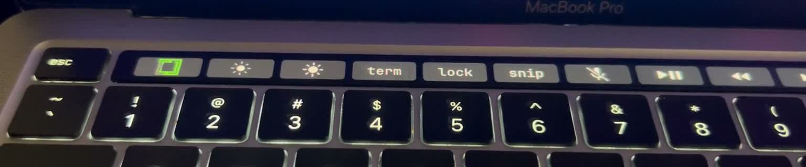

# Omarchy Touch Bar

A native Touch Bar experience for Omarchy: an animated Omarchy menu, hold-to-dictate, brightness/media controls, and labels that follow the desktop font.

This community project combines Austin Dixson's [Touch Bar plugin](https://github.com/austindixson/omarchy-touchbar) with the **`omarchy-touchbar` Arch package**, built from a [tiny-dfr fork](https://github.com/guirossibrum/tiny-dfr). It is not an official Omarchy package yet.

## Hardware demo

[](assets/touchbar-demo.mp4)

[Watch the 14.7-second hardware video](assets/touchbar-demo.mp4). Recorded on an iPhone, cropped to the Touch Bar and muted for publication. This is a physical MacBook recording, not a render or mockup.

## What it does

- **Tap the Omarchy logo:** open the menu. **Hold for 600 ms:** dictate using the default backend selected in Omarchy; release to stop. Superwhisper and other configured backends use the same Omarchy adapter.
- **Native animation:** gray/green fronts start inside a rail, travel both ways, split at mapped junctions, and merge without jumping. Timing uses Omarchy's existing Rust ttfx Wipe engine with linear easing.
- **One-second green hold:** gray starts filling green immediately; the fully green logo holds for one second before fading along the rails again.
- **System-font labels:** text is centered on a shared baseline. Changing the Omarchy font updates the Touch Bar automatically, without reapplying the layout, restarting the daemon, or requesting administrator access.
- **Normal controls:** screen brightness, terminal, lock, screenshot, microphone mute, playback, and volume. Hold Fn for F1–F12.
- **Idle behavior:** animation continues while dimmed, and sleeps when the Touch Bar is fully off or its animated layer is hidden. Existing lid policy remains in control.

The physical demo shows the animation and controls; it does not demonstrate every gesture or font-change case. See [validation notes](VALIDATION.md) for what was tested.

## Install

Tested on an **M1 13-inch MacBook Pro / aarch64 Omarchy**. Setup supports only the Apple Silicon Touch Bar models **M1 `apple,j293` (MacBookPro17,1)** and **M2 `apple,j493` (Mac14,7)**. M2 is detected but has not been tested here. Other Macs and x86 machines are skipped before changing layouts, bindings, font state, packages, or requesting administrator privileges. Uninstall remains available on unsupported machines.

Hardware detection prefers Omarchy's `omarchy-hw-touchbar`, then its existing `omarchy-hw-match-device-tree`, with a bounded, exact NUL-delimited `/proc/device-tree/compatible` fallback for older installations. All paths require aarch64. Root resolves helpers only from `/usr/bin` or `/bin`; helpers run in protected Bash without development fixture overrides. Detection uses the built-in hardware model rather than active DRM outputs, so closing the lid or temporarily powering down the Touch Bar does not disable setup. The packaged udev rules identify these models' Touch Bar inputs; this guard deliberately limits this integration to those Apple Silicon models.

The proposed change to the main Omarchy `quattro` branch adds hardware detection and optional setup documentation. It does not install this community package by default or publish it into Omarchy's package repositories. This plugin and its native package remain separate dependencies; the manual setup below is still required.

Run `python3 tests/test-hardware.py`, `bash tests/test-bindings-io.sh`, `bash tests/test-font-sync.sh`, and `bash tests/test-trace-layout.sh` for local checks. Tests use explicit compatible-file fixtures through `tests/hardware-fixture.py`, which copies entrypoints into a temporary directory and replaces only their detector adapter with the real parser pointed at the fixture. Production entrypoints accept no fixture path or force-install switch, and fixture tests never select live Omarchy helpers or write real desktop configuration.

Install build prerequisites if needed:

```bash
omarchy pkg add base-devel rust git pkgconf
```

Install this fork using the original plugin ID; replace the original plugin rather than enabling two copies:

```bash
omarchy plugin add https://github.com/guirossibrum/omarchy-touchbar.git --enable --yes
cd ~/.config/omarchy/plugins/io.github.austindixson.touchbar
./install-native.sh
./enable-animation.sh
```

`install-native.sh` builds the pinned Arch package as your user, then installs it through pacman. It provides/conflicts with `tiny-dfr`, so there is one daemon provider. It retains `tiny-dfr.service`, the udev rules and existing config interface. Build output stays in the user cache.

`enable-animation.sh` backs up your layout, configures the first-position logo and hold action, and applies the layout. Initial package installation and layout application require authorization. Later font changes do not.

The package declares its library dependencies; if makepkg reports missing dependencies, install those packages with `omarchy pkg add` and retry. Select a dictation backend under **Setup → Defaults → Dictation** before using hold-to-talk.

## Customize

The user layout is `~/.config/omarchy/touchbar.json`. Edit it and run the plugin's `apply.sh` to apply button changes. Fonts follow automatically through Omarchy's `font-set` hook when `fontTemplate` is `"system"` (the default).

- `layout.json`: static logo and normal controls.
- `layout-animated.json`: a complete animated example.
- `assets/omarchy-trace.json`: colors, line width, speed and green-hold duration.
- [TOPOLOGY.md](TOPOLOGY.md): all 18 nodes, 19 rails, six junctions and 495 simple routes.
- [Implementation and original plugin notes](docs/IMPLEMENTATION.md): schema, input behavior and security details.

## Package and review

The daemon and desktop integration have separate responsibilities:

| Component | Owns |
| --- | --- |
| [`omarchy-touchbar` package](packaging/omarchy-touchbar/README.md) | Native daemon, compatible executable/service, udev rules and shared assets |
| This user plugin | Layout, Omarchy logo, menu/dictation bindings and font hooks |

The daemon source and Rust dependencies are pinned. The effect engine is reused as a library; no terminal, animation subprocess, or configuration-reload loop drives the animation. Font updates use an event-driven, bounded user-owned runtime channel after the daemon drops privileges.

[Dependency proposal](packaging/omarchy-touchbar/PROPOSAL.md) · [Validation](VALIDATION.md) · [Upstream review scope](UPSTREAM.md)

## Roll back

```bash
./install-native.sh --uninstall
```

This restores stock `tiny-dfr` through pacman and removes the automatic-font hooks. The static logo/layout fallback remains usable. Plugin removal is separate:

```bash
omarchy plugin remove io.github.austindixson.touchbar
```

## Development checks

```bash
bash tests/test-bindings-io.sh
bash tests/test-trace-layout.sh
bash tests/test-font-sync.sh
```

Native tests and the headless renderer are documented in the daemon fork's [TRACE.md](https://github.com/guirossibrum/tiny-dfr/blob/feature/animated-outline/TRACE.md). The current package was built and tested on aarch64; the results are not a claim of official Omarchy release qualification.

## Credits and license

Plugin by Austin Dixson, extended by Guilherme Rossi Brum. Native hardware support is built on Asahi Linux's tiny-dfr; animation timing reuses Omarchy's ttfx. Omarchy's logo remains its mark and does not imply endorsement.

Plugin: MIT. Native daemon and bundled assets retain their upstream MIT/Apache-2.0 licenses.
