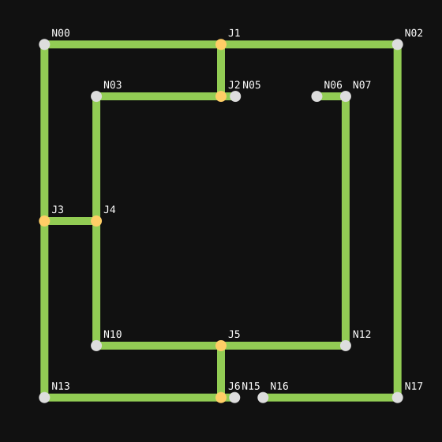

# Logo routing

The map contains 18 nodes and 19 unique rails. Four nodes are dead ends, eight
are corners, and six are three-way junctions. All coordinates are normalized to
the icon square. Each arriving front takes every outgoing unvisited rail:

| Junction | Node | Position | Incoming → outgoing |
| --- | --- | --- | --- |
| J1 | N01 | 0.500, 0.034 | 1 → 2 |
| J2 | N04 | 0.500, 0.171 | 1 → 2 |
| J3 | N08 | 0.034, 0.500 | 1 → 2 |
| J4 | N09 | 0.171, 0.500 | 1 → 2 |
| J5 | N11 | 0.500, 0.829 | 1 → 2 |
| J6 | N14 | 0.500, 0.966 | 1 → 2 |

The renderer also supports degree-4 and higher junctions (1 → 3 or more). There
are no degree-4 junctions in this particular logo.

## Starts between nodes

A source at distance `s` along a rail of length `L` between nodes A and B reaches
A after `s / speed` and B after `(L-s) / speed`. Both fronts begin together.
Sources are strictly inside rails and remain at least one line-width away from
both endpoint nodes. Short stubs without that clearance cannot be selected.

All continuations are known from the graph. For any other node X, its earliest
arrival distance is the minimum of `s + distance(A,X)` and
`L-s + distance(B,X)`. Weighted shortest distances are precomputed, so corners
do not change speed and forks do not require a runtime route search.

On any rail, fronts advance from whichever endpoints have been reached. Where
two fronts meet they merge; the remaining gap closes continuously. The source
rail additionally gets a span growing directly from its interior start. Spans
are merged before painting. Every rail is fully covered before a pass ends.

## Complete path export

`assets/omarchy-topology.json` lists every node, degree, coordinate and rail.
`assets/omarchy-routes.json` lists **all 495 simple paths** between the 153
unordered node pairs. Reverse-direction paths use those lists reversed. Repeated
walks around cycles are unnecessary and unbounded, so the export excludes them.

Regenerate it with `python3 tools/map-logo.py`. The plugin tests verify every
exported path stays on mapped rails and visits each node at most once.
The runtime uses shortest arrival distances rather than scanning this export.

## Timing

The shared ttfx Wipe uses `Linear` easing, with interpolation between samples.
`DurationSeconds` sets the time to travel the graph's node-to-node diameter,
giving a fixed physical travel speed across all source locations. A pass may
finish sooner when its source is centrally located. `PauseSeconds` begins only
after its last front fills the last gap.
