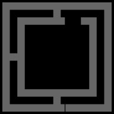

# Touch Bar for Omarchy

> Historical native-only packaging notes. The [main integration PR](https://github.com/omacom/omarchy/pull/17826) supersedes the source-build setup below with one prebuilt daemon/plugin package. Installation and updates never compile; recipes are for release builders only. See the [current README](https://github.com/guirossibrum/omarchy-touchbar#readme).

This community fork keeps Austin Dixson's plugin and adds a native animated
Omarchy menu icon in the first position. Gray traces to green, then green back
to gray, with a different starting point each pass. The key still opens the
Omarchy menu. The animation uses the **actual ttfx Wipe effect** from Omarchy's
Rust screensaver engine, through a companion tiny-dfr fork.



## Animated setup

Install this fork as the plugin, then build/install the companion
`omarchy-touchbar` Arch package. It uses the original plugin ID; replace the original
installation rather than enabling two copies.

From a checkout of this repository:

```sh
./install-native.sh
./enable-animation.sh
```

The first command builds the pinned [omarchy-touchbar Arch package](../packaging/omarchy-touchbar/README.md) as your user and installs it with pacman. The package provides and conflicts with `tiny-dfr`, replacing the stock package cleanly. Existing `tiny-dfr.service`, udev and config interfaces remain compatible. The setup helper migrates the earlier development override; the daemon is now package-owned under `/usr/bin`, not an untracked executable in `/usr/local`.

The second command backs up your layout, moves the menu button first, enables its trace and hold action, installs the logo asset, and applies your configuration. Other buttons and user brightness bindings remain intact. Building needs Rust, GCC, git, pkgconf and the declared library dependencies; package tests run before installation. Only package installation and the initial layout apply require authorization.

`layout.json` is the static default; `layout-animated.json` is a complete animated
example. `enable-animation.sh` preserves your own layout rather than replacing
it with that example. Set `trace` on the menu button to the numeric object in
`assets/omarchy-trace.json` to tune colors, width, speed, and pause. Removing it
restores the static green glyph. Adaptive brightness stays enabled.

The daemon uses ttfx to generate a 128-sample Wipe mask once on load, then drops
the effect engine. Playback runs in tiny-dfr's existing Rust event loop, at
roughly 15 fps, with only animated buttons marked dirty. There are no animation
subprocesses, terminal windows, config-reload loops, or frame-image assets.
Animation continues at idle-dim brightness. Wakeups stop on the Fn layer and
when the Touch Bar is fully off, including lid-close power-off.
Starting points are chosen by ttfx's RNG; the stored sequence repeats after 64
passes and adjacent passes always differ.

The logo is an explicit graph of 18 nodes, 19 rails, and six three-way junctions.
A start is always inside a rail, at least one line-width away from both nodes.
It launches fronts in both directions. At a junction each front continues into
every unvisited outgoing rail; fronts merge when they meet, including around
loops. Linear ttfx Wipe timing keeps the travel speed consistent through corners
and forks. More simultaneous fronts can change more pixels, but no front accelerates.

`DurationSeconds` sets the time to travel the graph's longest node-to-node distance;
the same distance-per-second applies to all starts. A pass finishes when its last
front arrives. Only the fully green state holds for `PauseSeconds` (one second
by default); fully gray immediately begins recoloring green. `assets/omarchy-topology.svg` labels
all nodes and forks; [TOPOLOGY.md](../TOPOLOGY.md) explains the routing and complete
route export.

### Logo tap/hold and text labels

Tap the logo to open the Omarchy menu. Hold it for 600 ms to start push-to-talk
with the backend selected in **Setup > Defaults > Dictation**; release to stop.
Sliding off cancels without opening the menu. The plugin calls `omarchy dictation
start/stop`, so it does not hard-code Superwhisper, Voxtype or another backend.
Changing the default backend takes effect on the next gesture. Configure it in
Omarchy before using the hold action.

`fontTemplate` defaults to `"system"`: apply.sh resolves the user's selected
monospace family through fontconfig. On this machine that is JetBrainsMono Nerd
Font. The daemon uses a shared baseline and centers text by its visible bounds,
so `term`, `lock` and `snip` align. Font changes through Omarchy update the
Touch Bar automatically via its `font-set` hook. The daemon listens for a small
user-owned runtime state update; no reapply, restart, polling process, or
authentication prompt is required. A `post-boot` hook restores the selected font
after login. Set `fontTemplate` to a specific
fontconfig pattern if you prefer a different family or weight.

The fully green logo holds for one second; gray starts refilling immediately.
Animation remains active while idle-dimmed, and stops when the bar is fully off.

### Rollback

```sh
./install-native.sh --uninstall
```

This replaces `omarchy-touchbar` with stock `tiny-dfr` through pacman and removes
the user font-sync hooks. It ignores the `Trace` field and displays the
static icon. Your menu action, layout and adaptive brightness remain available.

### Validation and upstream review

```sh
bash tests/test-bindings-io.sh
bash tests/test-trace-layout.sh
bash tests/test-font-sync.sh
```

Native tests and a headless preview renderer are documented in the companion
fork's [TRACE.md](https://github.com/guirossibrum/tiny-dfr/blob/feature/animated-outline/TRACE.md).
The preview above uses that exact Rust renderer, without DRM or root.
See [UPSTREAM.md](../UPSTREAM.md) for the dependency boundary and proposed PR scope.

Puts Omarchy actions on the Mac Touch Bar using [tiny-dfr](https://github.com/AsahiLinux/tiny-dfr). Tested on MacBookPro17,1 (M1 13-inch).

**Default strip (no Fn):** Omarchy menu, brightness, terminal, lock, screenshot, mic mute, play/prev/next, mute/volume.

**Hold Fn:** F1–F12.

tiny-dfr can only inject keycodes. Menu uses `XF86Search`. Terminal and lock emit `KEY_F13` / `KEY_F14`; Hyprland binds those as `code:191` / `code:192` because the default `us` keymap has no F13/F14 keysyms.

## Requirements

- Apple Silicon Mac with a Touch Bar
- `tiny-dfr` (Asahi / Arch ARM). The plugin does not install the package.
- Writing `/etc/tiny-dfr/config.toml` uses `pkexec` when there is no terminal (polkit prompt from the shell), or `sudo` from a real TTY. Elevation helpers (`install`, `systemctl`, `pkexec`, `sudo`, `bash`) are taken from fixed system paths, not PATH.
- Restarting `tiny-dfr.service` after that copy; failures are reported with an Omarchy notification

## Install

```bash
omarchy plugin add https://github.com/guirossibrum/omarchy-touchbar.git --enable --yes
```

Then apply the default layout (polkit or sudo prompt for `/etc/tiny-dfr`):

```bash
~/.config/omarchy/plugins/io.github.austindixson.touchbar/apply.sh
```

Hyprland reloads `bindings.lua` on save. If the Touch Bar keys do nothing, `hyprctl reload`.

## Customize

Copy the stock layout and edit it:

```bash
cp ~/.config/omarchy/plugins/io.github.austindixson.touchbar/layout.json \
   ~/.config/omarchy/touchbar.json
```

Edit `~/.config/omarchy/touchbar.json`, then run `apply.sh` again to regenerate the tiny-dfr config. The service does not watch this file. Each button:

| Field | Meaning |
|---|---|
| `icon` or `text` | Label (`icon` is a name under `/usr/share/tiny-dfr/` without extension) |
| `key` | tiny-dfr key (`BrightnessUp`, `F13`, `Print`, or a combo array) |
| `hyprKey` + `command` | Optional Hyprland bind for Omarchy commands |

`mediaLayerDefault`: `true` shows this row without Fn.

The plugin only replaces `/etc/tiny-dfr/config.toml` when that file is missing or already generated by this plugin. Hand-written tiny-dfr configs are left alone.

## Security

- `apply.sh` checks the layout file before it reads it. The file must be a regular file of at most 64 KiB (65536 bytes). Symlinks, FIFOs, directories, and devices are refused, and the script exits non-zero with a message on stderr. The checks run again on the opened file descriptor (`O_NOFOLLOW`, non-blocking), so swapping the file after the check does not get past them.
- `apply.sh` reads `~/.config/hypr/bindings.lua` the same way (no-follow, non-blocking, regular file only, at most 256 KiB) and updates it by writing an exclusive temporary file in the same directory and atomically renaming it over the original, keeping the existing file mode. A symlink, FIFO, directory, device, or oversized file at that path is refused (non-zero exit, nothing written). A missing file is skipped.
- The Quickshell service does not watch or read `~/.config/omarchy/touchbar.json`. The layout only changes when you run `apply.sh`.

## Changelog

### 1.1.3

- `apply.sh` no longer uses `os.path.isfile()`, an unbounded `open().read()`, or a truncating `open(..., "w")` on `~/.config/hypr/bindings.lua`. The read is bounded (256 KiB), `O_NOFOLLOW | O_NONBLOCK`, and regular-file only; the update goes through an exclusive temp file plus `os.replace`, preserving the file mode. Symlinks and FIFOs are refused instead of followed or stalled on ([marketplace #9252](https://github.com/omacom/omarchy-plugin-marketplace/issues/9252))

### 1.1.2

- Remove the `FileView` auto-load and watch of `~/.config/omarchy/touchbar.json` from `Service.qml`. It followed symlinks and had no size cap, so a FIFO or a large file at that path could stall the shell ([marketplace #6878](https://github.com/omacom/omarchy-plugin-marketplace/issues/6878), HANCORE FileView+FIFO finding)
- `apply.sh` validates user and stock layouts before reading them: regular file only, no symlinks, no FIFOs or devices, 64 KiB cap. It fails closed instead of falling back to the stock layout

### 1.1.1

- Resolve `install`, `systemctl`, `pkexec`, `sudo`, and `bash` from fixed system paths before elevation so a user-writable PATH cannot substitute code at the pkexec/sudo boundary ([marketplace #6047](https://github.com/omacom/omarchy-plugin-marketplace/issues/6047))

### 1.1.0

- Apply layout through `pkexec` when the Omarchy shell has no TTY; keep `sudo` for a terminal
- Surface install/restart failures with a critical desktop notification
- Bind term/lock by evdev keycode (`code:191` / `code:192`) so they work on the default `us` map

## Remove

```bash
omarchy plugin remove io.github.austindixson.touchbar
```

That does not uninstall `tiny-dfr` or delete `/etc/tiny-dfr/config.toml`. To restore the packaged tiny-dfr template:

```bash
sudo cp /usr/share/tiny-dfr/config.toml /etc/tiny-dfr/config.toml
sudo systemctl restart tiny-dfr.service
```

Remove the managed bind block in `~/.config/hypr/bindings.lua` between `-- io.github.austindixson.touchbar begin` and `-- io.github.austindixson.touchbar end` if you added one.

## License

MIT. Depends on `tiny-dfr` (MIT) at runtime.
